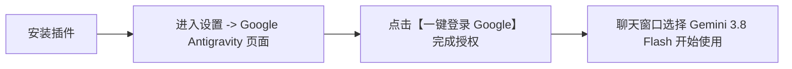

<div align="center">

# dsh-plugin-antigravity-acp

**DeepSeek Harness (DSH) 插件：通过 Google ACP 协议接入 Antigravity 运行时与 Gemini 3.x 模型**

[简体中文](README.md) · [English](README_en.md)

[](https://github.com/deepseek-ai)
[](LICENSE)
[](package.json)
[](https://github.com/agentclientprotocol)

</div>

---

## 简介

`dsh-plugin-antigravity-acp` 是 DeepSeek Harness (DSH) 的扩展插件。通过标准的 ACP (Agent Client Protocol) 协议连接 Google Antigravity 运行时，让 DSH 可以直接调用 Gemini 3.8 Flash 模型。

插件自带设置页面和后台服务，安装后通过 Google 官方 OAuth 授权登录即可使用，支持思维链推理展开、流式输出和 100 万 Token 上下文。

---

## 特性

- **自带设置界面**：安装后自动在 DSH【设置】->【插件】顶部注入专属「Google Antigravity」标签页，并在设置侧边栏提供独立入口，无需手动修改配置文件。
- **自动下载官方运行时**：无需手动安装 Python、GCC 或配置编译环境。首次运行时自动识别系统（Windows / macOS / Linux），从 Google 官方 CDN 下载对应架构的 `agy_acp_server` 并校验 SHA256。
- **官方 OAuth 2.0 个人授权**：支持 ACP `oauth-personal` 流程。点击登录后调用系统默认浏览器打开 Google 官方页面授权，无需手动抓取 Cookie 或填写 API Key，插件不接触账号密码明文。
- **原生模型接入与流式输出**：授权后在聊天窗口直接选择 `Gemini 3.8 Flash (Antigravity)`，支持思维链推理过程展开（Reasoning Delta）和正文流式输出。
- **配额与状态监控**：内置配额查询服务，可实时查看 Google 账号 Tier 状态与调用限额。
- **本地存储与隐私安全**：无第三方中转服务器，无遥测埋点。授权凭证仅保存在本机 `~/.gemini/antigravity-acp/` 目录，请求由本地进程直连 Google 官方接口。

---

## 安装

### 方式 1：在 DSH 界面中安装（推荐）

1. 打开 DSH 桌面端；
2. 进入【设置】->【插件】；
3. 在安装输入框中粘贴仓库地址：
   ```text
   https://github.com/Lovexiaoxiaowo/dsh-plugin-antigravity-acp
   ```
4. 点击【安装】，等待安装完成。

---

### 方式 2：通过命令行安装

在终端执行：

```bash
dsh plugin add https://github.com/Lovexiaoxiaowo/dsh-plugin-antigravity-acp
```

---

## 使用步骤



1. **打开设置面板**：安装完成后，进入 DSH【设置】->【插件】-> 顶部【Google Antigravity】标签页（或左侧导航栏的【Google Antigravity】入口）。
2. **完成 Google 授权**：在面板中点击【一键登录 Google】，系统会打开浏览器前往 Google 官方登录页。授权完成后返回 DSH，面板会更新为已连接状态。
3. **选择模型并使用**：新建或打开任意对话，在模型下拉列表中选择 `Gemini 3.8 Flash (Antigravity)`，即可开始对话。

---

## 安全性与方案对比

| 项目 | 常见网页抓取 / 第三方镜像方案 | 本插件 (dsh-plugin-antigravity-acp) |
| :--- | :--- | :--- |
| **接入协议** | 模拟网页请求、逆向非公开接口 | Google 官方规范 ACP (Agent Client Protocol) |
| **可执行文件** | 来源不明的第三方二进制 | Google 官方 CDN 签名发布 + SHA256 完整性校验 |
| **认证方式** | 提取 Cookie 或私有 Session Token | Google 官方标准 OAuth 2.0 个人应用授权 |
| **数据链路** | 经第三方中转服务器，存在泄露风险 | 零中间服务器，本地进程直连 Google 官方接口 |
| **风控与安全** | 容易触发平台风控导致封号 | 走官方授权通道，正常个人应用调用 |

---

## 常见问题

### Q1：安装或更新插件后，为什么聊天界面没有出现模型？
- **原因**：Windows 桌面端点击窗口右上角 `X` 默认最小化到系统托盘，旧进程仍在后台运行。
- **解决方式**：在任务栏右下角托盘找到 DSH 图标，右键选择【退出】，然后重新打开 DSH 即可。

### Q2：为什么未授权时在模型列表中看不到 Antigravity？
- **原因**：为避免未登录时请求报错，插件只在完成 Google 授权后才会向聊天列表注入可用模型。

### Q3：支持哪些操作系统？
- 支持 Windows (x64 / arm64)、macOS (Apple Silicon / Intel)、Linux (x64 / arm64)。启动时会自动识别平台并下载对应二进制文件。

---

## 项目结构

```
dsh-plugin-antigravity-acp/
├── cordis.patch.yml       # DSH bundle patch 规范声明
├── dsh/
│   └── client.js          # DSH 前端扩展（向设置页注入 UI）
├── src/
│   ├── index.ts           # 插件服务入口、LlmAdapter 注册与 Web 路由桥接
│   ├── bootstrapper.ts    # 官方二进制跨平台下载与 SHA256 校验
│   ├── auth.ts            # OAuth 凭据管理、本地存储与 Token 刷新
│   ├── acp-client.ts      # @agentclientprotocol/sdk 双向通信与流式处理
│   ├── quota-service.ts   # Google 账号配额与 Tier 状态查询
│   ├── session-manager.ts # 会话生命周期与上下文绑定
│   ├── event-mapper.ts    # ACP 协议事件转 DSH 流式事件
│   └── runtime-manifest.json # 官方下载源与哈希列表
├── dist/                  # 预编译产物（包含在仓库中，无需本地编译）
├── package.json
├── README.md              # 中文说明文档（默认）
└── README_en.md           # 英文说明文档
```

---

## 参与贡献

欢迎提交 Issue 和 Pull Request：
- 项目仓库：[GitHub Repository](https://github.com/Lovexiaoxiaowo/dsh-plugin-antigravity-acp)
- 问题反馈：[Issues Tracker](https://github.com/Lovexiaoxiaowo/dsh-plugin-antigravity-acp/issues)

---

## 开源协议

本项目采用 [MIT License](LICENSE) 协议。
