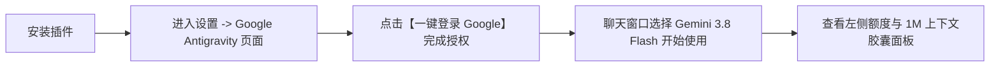

<div align="center">

# dsh-plugin-antigravity-acp

**DeepSeek Harness (DSH) 插件：通过 Google ACP 协议接入 Antigravity 运行时与 Gemini 3.x 模型**

[简体中文](README.md) · [English](README_en.md)

[](https://github.com/deepseek-ai)
[](LICENSE)
[](package.json)
[](https://github.com/agentclientprotocol)

</div>

---

## 简介

`dsh-plugin-antigravity-acp` 是 DeepSeek Harness (DSH) 的扩展插件。通过标准的 ACP (Agent Client Protocol) 协议连接 Google Antigravity 运行时，让 DSH 可以直接调用 Gemini 3.8 Flash 模型。

插件自带设置页面和后台服务，安装后通过 Google 官方 OAuth 授权登录即可使用，支持思维链推理展开、流式输出、输入框左侧额度与 1M 上下文实时看板、ACP 思考轨迹与计划同步，以及跨进程失效透明自愈。

---

## 特性

- **输入框模型旁额度与 Context 看板**：在聊天窗口底部模型选择框左侧常驻展示额度胶囊（`⚡ 5h 95% | 上下文 7.2%`），悬停自动展开 Popover 浮层，鼠标移出 300ms 平滑隐藏，避免遮挡聊天输入区。
- **5 小时滚动周期与倒计时**：清晰呈现 Google 官方独特的 5 小时动态滑动窗口（5-Hour Rolling Window）机制与精准重置倒计时，解除周重置误解。
- **1M 上下文占用与超限告警**：基于 Gemini 3.8 Flash 的 1,048,576 Token 上限，实时计算已占比例；当超过 75% 时主动呈现高危黄色/红色警示卡片，提醒及时归档或压缩会话。
- **DSH 轨迹原生工具调用发射**：重构流式事件映射器，完整实现 DSH 官方原生的 `block-start` (`blockType: 'tool-call'`)、`tool-call-delta` 与 `block-end` 协议，彻底解决 DSH 轨迹看板中「0 工具调用」统计缺失的问题，工具名与参数清晰可查。
- **ACP 轨迹跟踪与思维链**：将 ACP 运行时的思考过程（Reasoning Delta）、工具执行（Tool Calls）、代码补丁（Diff）与计划（Plan）完整映射并流入 DSH 思考链与轨迹面板，调试排错一目了然。
- **上下文自动保全与系统时间戳穿透**：智能识别并穿透 DSH 系统注入消息（如 `@deepseek-ai/dsh-time-context` 时间戳），精准提纯用户真实提问，彻底解决多轮对话历史丢失或答非所问问题。
- **跨进程会话失效透明自愈（Auto-Recovery）**：当遇到 DSH 客户端退出重启、服务重启或服务端 Session 过期（`Session not found / code: -32603`）时，自动静默创建新会话并打包前序历史完成重试，无感自愈，彻底杜绝 `Internal error` 报错。
- **自带设置界面**：安装后自动在 DSH【设置】->【插件】顶部注入专属「Google Antigravity」标签页，并在设置侧边栏提供独立入口，无需手动修改配置文件。
- **自动下载官方运行时**：无需手动安装 Python、GCC 或配置编译环境。首次运行时自动识别系统（Windows / macOS / Linux），从 Google 官方 CDN 下载对应架构的 `agy_acp_server` 并校验 SHA256。
- **官方 OAuth 2.0 个人授权**：支持 ACP `oauth-personal` 流程。点击登录后调用系统默认浏览器打开 Google 官方页面授权，无需手动抓取 Cookie 或填写 API Key，插件不接触账号密码明文。
- **本地存储与隐私安全**：无第三方中转服务器，无遥测埋点。授权凭证仅保存在本机 `~/.gemini/antigravity-acp/` 目录，请求由本地进程直连 Google 官方接口。

---

## 版本更新日志 (Changelog)

### v1.0.9 (2026-10-30)
- **修复工具调用导致的 `unknown tool` 异常与报告消失**：
  - 彻底阻断对外层 DSH 调度器发射未注册工具块（`blockType: 'tool-call'`），将 ACP 内部工具执行完整收拢流入思维链轨迹；
  - 彻底修复 `DshStreamWriter` 状态机 Block Index 冲突，防止 index: 1 文本槽位被冲刷覆盖；
  - 解决 PTC 模式下因宿主调度失败导致的多轮空转死循环与 5M+ Token 异常消耗。

### v1.0.8 (2026-10-30)
- **工具调用原生轨迹发射**：重构 `DshStreamWriter`，实现官方 `blockType: 'tool-call'` 结构化流式发射，修复 DSH 轨迹看板中工具调用显示为 0、无详细工具名和参数的问题。
- **浮层交互易用性提升**：浮窗支持鼠标离开 300ms 后平滑自动隐藏；底栏胶囊支持悬停自动展开，彻底杜绝浮窗遮挡聊天发送区域。
- **额度恢复机制详解**：浮窗新增「Google 5 小时动态滑动窗口（5-Hour Rolling Window）」机制卡片与实时重置倒计时，明确非自然周重置规则。
- **1M 上下文超限健康预警**：当单会话上下文突破 75%（>78万 Tokens）时主动弹出警示卡片，提示 Google API 硬顶崩溃风险与上下文压缩建议。

### v1.0.7 (2026-10-30)
- **跨进程 Session 失效透明自愈**：解决 DSH 重启或服务端过期导致的 `Session not found / code: -32603` 内部错误。
- **时间戳穿透与历史净化**：穿透 `@deepseek-ai/dsh-time-context` 注入的消息并纯化真实上下文。

### v1.0.6 (2026-10-30)
- **输入框模型旁额度与 Context 看板**：首发常驻底栏胶囊，展示 5h 额度、1M 上下文占用比例与输入/输出/思考 Token 记账。

---

## 安装

### 方式 1：在 DSH 界面中安装（推荐）

1. 打开 DSH 桌面端；
2. 进入【设置】->【插件】；
3. 在安装输入框中粘贴仓库地址：
   ```text
   https://github.com/Lovexiaoxiaowo/dsh-plugin-antigravity-acp
   ```
4. 点击【安装】，等待安装完成。

---

### 方式 2：通过命令行安装

在终端执行：

```bash
dsh plugin add https://github.com/Lovexiaoxiaowo/dsh-plugin-antigravity-acp
```

---

## 使用步骤



1. **打开设置面板**：安装完成后，进入 DSH【设置】->【插件】-> 顶部【Google Antigravity】标签页（或左侧导航栏的【Google Antigravity】入口）。
2. **完成 Google 授权**：在面板中点击【一键登录 Google】，系统会打开浏览器前往 Google 官方登录页。授权完成后返回 DSH，面板会更新为已连接状态。
3. **选择模型并使用**：新建或打开任意对话，在模型下拉列表中选择 `Gemini 3.8 Flash (Antigravity)`，即可开始对话。
4. **实时看板交互**：在输入框右下方模型选择器左侧，点击 `⚡ 5h 95% | 上下文 x%` 胶囊，即可随时查看当前额度倒计时与 Token 消耗。

---

## 安全性与方案对比

| 项目 | 常见网页抓取 / 第三方镜像方案 | 本插件 (dsh-plugin-antigravity-acp) |
| :--- | :--- | :--- |
| **接入协议** | 模拟网页请求、逆向非公开接口 | Google 官方规范 ACP (Agent Client Protocol) |
| **可执行文件** | 来源不明的第三方二进制 | Google 官方 CDN 签名发布 + SHA256 完整性校验 |
| **认证方式** | 提取 Cookie 或私有 Session Token | Google 官方标准 OAuth 2.0 个人应用授权 |
| **数据链路** | 经第三方中转服务器，存在泄露风险 | 零中间服务器，本地进程直连 Google 官方接口 |
| **风控与安全** | 容易触发平台风控导致封号 | 走官方授权通道，正常个人应用调用 |

---

## 版本历史 (Changelog)

### v1.0.7
- **跨进程失效全自动静默自愈**：底层捕获 `Session not found` 及 `-32603` 内部错误时，自动清理陈旧 Session、重新创建 ACP 实例并打包历史重新执行，彻底杜绝客户端重启后的 `Internal error` 报错。
- **任务防挂起清理**：排查并彻底清除多余后台挂起任务。

### v1.0.6
- **穿透 DSH 系统时间戳**：精准识别并穿透 `@deepseek-ai/dsh-time-context` 注入的时间消息，锁定用户真实提问，彻底根治“答非所问/上下文错位”问题。
- **修复 1M 模型匹配与 Token 虚标**：精准过滤 16K 代码补全小模型，准确绑定 1,048,576（1M）真实上下文；修正高频流式通知累加导致的 350 万 Token 虚标与 100% 爆表假象。

### v1.0.5
- **全新额度与上下文胶囊看板**：在输入框模型下拉框左侧注入原生交互胶囊与 Popover 浮层，提供 5 小时额度滑动窗口、重置倒计时及 Token 明细。
- **ACP 轨迹映射**：支持将 ACP 的 Plan 规划与 Tool 轨迹流式同步至 DSH 思考链。
- **持久化会话管理器**：实现 `DshSessionManager`，保障多轮对话连贯。

### v1.0.4 & 早期版本
- 修复重复标签页唤起与多平台二进制下载自举，支持标准 OAuth 2.0 授权。

---

## 常见问题

### Q1：安装或更新插件后，为什么聊天界面没有出现模型？
- **原因**：Windows 桌面端点击窗口右上角 `X` 默认最小化到系统托盘，旧进程仍在后台运行。
- **解决方式**：在任务栏右下角托盘找到 DSH 图标，右键选择【退出】，然后重新打开 DSH 即可。

### Q2：为什么未授权时在模型列表中看不到 Antigravity？
- **原因**：为避免未登录时请求报错，插件只在完成 Google 授权后才会向聊天列表注入可用模型。

### Q3：支持哪些操作系统？
- 支持 Windows (x64 / arm64)、macOS (Apple Silicon / Intel)、Linux (x64 / arm64)。启动时会自动识别平台并下载对应二进制文件。

---

## 项目结构

```
dsh-plugin-antigravity-acp/
├── cordis.patch.yml       # DSH bundle patch 规范声明
├── dsh/
│   └── client.js          # DSH 前端扩展（向设置页与输入框底栏注入 UI）
├── src/
│   ├── index.ts           # 插件服务入口、LlmAdapter 注册、Web 路由与自愈状态机
│   ├── bootstrapper.ts    # 官方二进制跨平台下载与 SHA256 校验
│   ├── auth.ts            # OAuth 凭据管理、本地存储与 Token 刷新
│   ├── acp-client.ts      # @agentclientprotocol/sdk 双向通信与流式处理
│   ├── quota-service.ts   # Google 账号配额与 Tier 状态查询
│   ├── session-manager.ts # 会话生命周期、真实提问提取与上下文绑定
│   ├── event-mapper.ts    # ACP 协议事件转 DSH 流式事件
│   └── runtime-manifest.json # 官方下载源与哈希列表
├── dist/                  # 预编译产物（包含在仓库中，无需本地编译）
├── package.json
├── README.md              # 中文说明文档（默认）
└── README_en.md           # 英文说明文档
```

---

## 参与贡献

欢迎提交 Issue 和 Pull Request：
- 项目仓库：[GitHub Repository](https://github.com/Lovexiaoxiaowo/dsh-plugin-antigravity-acp)
- 问题反馈：[Issues Tracker](https://github.com/Lovexiaoxiaowo/dsh-plugin-antigravity-acp/issues)

---

## 开源协议

本项目采用 [MIT License](LICENSE) 协议。
