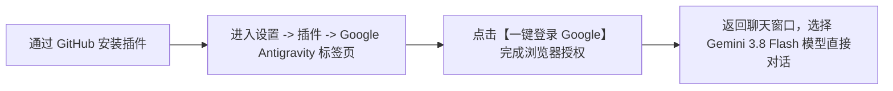

# dsh-plugin-antigravity-acp

[](https://github.com/deepseek-ai)
[](https://opensource.org/licenses/MIT)

> **DeepSeek Harness (DSH) 官方标准第三方插件**：基于标准 **ACP (Agent Client Protocol)** 协议直接连接 Google 官方的 **Antigravity 运行时**，为 DSH 用户带来开箱即用的 **Google Gemini 3.8 Flash** 官方大模型与顶配 Agent 智能体编程体验。

---

## 🌟 核心特性与架构设计

1. **项目自带完整 UI 前端与后台服务（双半身一体化）**
   - **完全自包含**：通过 GitHub 安装本插件后，**无需手动配置任何网页或修改任何系统文件**。
   - **自动注册 UI 面板**：DSH 会自动加载本仓库打包的 `dsh/client.js`，在 DSH 的 **【设置】->【插件】顶部自动注入专属「Google Antigravity」标签页**（并在设置左侧导航栏提供专属入口）。
2. **真正的开箱即用（Zero-Config & Self-Contained）**
   - 零前置依赖：用户电脑无需预装 Python、Node 构建工具或全局 `pi`。
   - 跨平台自举：首次运行时自动识别系统架构（Windows x64/arm64、macOS Apple Silicon/Intel、Linux），从 Google 官方 CDN 安全拉取签名运行时 `agy_acp_server`。
3. **官方标准 Google OAuth 2.0 一键授权**
   - 原生支持 ACP `oauth-personal` 规范。在插件标签页中点击按钮，即可在系统默认浏览器中调起 Google 官方授权页，无需手动抓取或复制任何 API Key。
4. **原生 DSH 模型选择器与全双工流式输出（LlmAdapter）**
   - 授权成功后，DSH 聊天窗口的模型下拉菜单中将自动出现 **`Gemini 3.8 Flash (Antigravity)`**。
   - 支持完整的**思考过程实时展开（Reasoning Delta）**与**正文流式输出（Text Delta）**。

---

## 🚀 一键安装指南

### 方式 1：在 DSH 桌面端界面中安装（推荐）

1. 打开 **DSH 桌面端 (DeepSeek Harness)**；
2. 点击左下角 **⚙️ 设置（Settings）** -> **插件（Plugins）**；
3. 在插件安装输入框中粘贴本 GitHub 仓库地址：
   ```text
   https://github.com/Lovexiaoxiaowo/dsh-plugin-antigravity-acp
   ```
4. 点击 **安装（Install）**；
5. DSH 底层包管理器会自动拉取本仓库的预构建产物并完成加载。

---

### 方式 2：通过 DSH 命令行安装

在终端执行：
```bash
dsh plugin add https://github.com/Lovexiaoxiaowo/dsh-plugin-antigravity-acp
```

---

## 📖 详细使用流程图解



### 步骤 1：打开项目自带的设置标签页
安装完成后，在 DSH 中即可直接看到本插件提供的操作面板：
- **入口 A**：点击左下角 **⚙️ 设置** -> **插件** -> 顶部新增的 **【Google Antigravity】标签页**；
- **入口 B**：在左侧设置导航菜单中，点击 **【⚡ Google Antigravity】** 专栏。

> **提示**：该设置面板由本项目代码自动注入渲染，包含 Google 连接状态、引擎状态监控与即时对话调试面板。

### 步骤 2：完成 Google 账号一键授权
1. 在上述面板中，点击 **【一键登录 Google】** 按钮；
2. 系统会自动调用默认浏览器打开 Google 官方安全授权登录页；
3. 登录并同意授权后，浏览器会提示授权完成，回到 DSH 界面，面板将自动变为 **“Google 账号已就绪 / 运行正常”**。

### 步骤 3：在聊天窗口中使用 Gemini 3.8 Flash 模型
1. 回到 DSH 主界面并新建或打开任意对话；
2. 点击顶部/底部的**模型选择下拉列表**；
3. 在模型分组中找到并勾选 **`Gemini 3.8 Flash (Antigravity)`**；
4. 发送任意提示词或代码任务，即可享受 Google Antigravity 官方带来的极速思考与代码生成！

---

## ❓ 常见问题排查（FAQ）

### Q1：安装或更新后，为什么聊天窗口还没显示新模型/设置没刷新？
- **原因**：Windows 桌面端点击窗口右上角 `X` 默认**只最小化到系统托盘**，旧版服务仍在后台内存中运行。
- **解决方法**：
  1. 查看 Windows 任务栏右下角折叠托盘（时间旁边的小箭头）；
  2. 找到 **DSH 图标，右键点击 -> 选择【退出 / Exit】**；
  3. 重新打开 DSH 客户端即可彻底加载最新代码。

### Q2：为什么未登录时在模型列表中看不到 Antigravity？
- **机制说明**：为了避免无效调用和报错，本插件设计了**严格的登录态门禁**。在用户未完成 Google 授权前，模型列表不会展示该选项；一旦在设置面板完成授权，模型将自动可用。

---

## 📂 项目结构

```
dsh-plugin-antigravity-acp/
├── cordis.patch.yml       # DSH 标准 bundle patch 规范声明
├── dsh/
│   └── client.js          # DSH 前端 UI 卡片 (基于 window.__ModuleLoader__ 与 Slots 注入)
├── src/
│   ├── index.ts           # DSH 宿主服务入口、LlmAdapter 适配与 WebServer 路由桥
│   ├── bootstrapper.ts    # 官方二进制跨平台自举下载与 SHA256 校验
│   ├── auth.ts            # OAuth 凭据管理与登录态维护
│   ├── acp-client.ts      # @agentclientprotocol/sdk 双向通信与流式解析
│   └── runtime-manifest.json # Google 官方下载源清单与签名哈希
├── dist/                  # 预编译产物 (随 Git 提交，确保 Git 安装零依赖零编译)
├── package.json
└── README.md
```

---

## 📄 License

[MIT License](LICENSE) © 2026 Lovexiaoxiaowo
