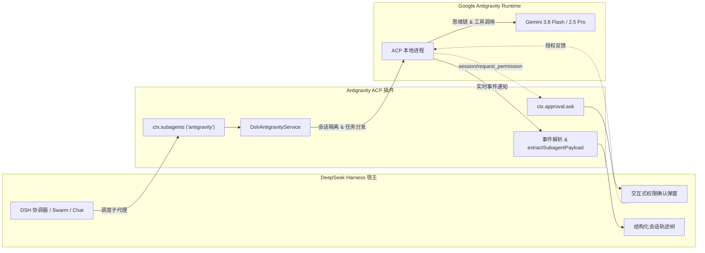

<div align="center">

# dsh-plugin-antigravity-acp

**DeepSeek Harness (DSH) 扩展插件：深度接驳 Google Antigravity ACP 运行时与 Gemini 3.x 高推理模型矩阵**

[简体中文](README.md) · [English](README_en.md)

[](https://github.com/deepseek-ai)
[](package.json)
[](https://github.com/agentclientprotocol)
[](LICENSE)

</div>

---

## 💡 项目简介

`dsh-plugin-antigravity-acp` 是专为 **DeepSeek Harness (DSH)** 打造的核心能力扩展插件。基于标准 **Agent Client Protocol (ACP)** 协议深度连接 Google Antigravity 本地运行时。

不同于将外部 Agent 强行作为普通 LLM 的简易方案，本插件深度接驳了 DSH 官方的核心能力规范——将 Antigravity 作为 **DSH 原生子代理（Native Subagent Provider）**，支持被 DSH 协调器、`/swarm` 和 `/teamwork` 原生调度分发，同时接驳宿主**交互式权限审批（Interactive Approval）**，实现强推理能力与安全治理的双重闭环。

---

## 🚀 核心特性

- **DSH 原生子代理调度 (`ctx.subagents`)**  
  提供 `antigravity` 与 `antigravity-acp` 原生子代理注册，完整遵循 DSH 官方 `SubagentProvider` 与 `SubagentRun` 规范。自动继承父会话工作区目录（`cwd`）并接驳外部中止信号（`signal`），使 DSH 协调器能直接委派高难度跨文件重构、全库审计等沉重子任务。
- **宿主级交互权限审批 (`ctx.approval`)**  
  将 ACP 敏感工具操作（终端执行、文件写入等）上浮至 DSH 原生交互弹窗，支持用户选择单次允许（`allowed-once`）、永久信任或拒绝，告别单方面静默越权。
- **结构化子任务树投影**  
  内置 `extractSubagentPayload` 提取器，将 ACP 内部的工具调度、任务分发与 Swarm 载荷结构化投影至 DSH 会话中，呈现清晰的分级执行树。
- **输入框实时配额看板**  
  在聊天窗口底栏常驻显示额度状态胶囊（`⚡ 5h 95% | 周重置`），鼠标悬停自动展开 Popover 浮层，直观呈现 Google 独特的 5 小时滑动窗口与自然周配额重置倒计时。
- **Gemini 3.x / 2.5 官方旗舰模型矩阵**  
  完整接入 Gemini 3.8 Flash（1M 超长上下文）、Gemini 2.5 Pro、Flash Thinking 等模型，支持完整思维链展开与多模态图片识别理解。
- **透明自愈与韧性管道**  
  跨进程会话失效自动无感重建、流式背压水线保护与超时熔断，杜绝空转异常。
- **零配置与隐私安全**  
  启动时自动按系统架构（Windows / macOS / Linux）下载并校验 Google 官方二进制；通过官方 OAuth 2.0 登录，授权凭证本地安全保存，请求直接直连 Google 端点，无任何中间服务器或遥测行为。

---

## 🛠️ 架构协同



---

## 📦 安装与配置

### 方式 1：DSH 客户端界面安装（推荐）

1. 打开 DeepSeek Harness 桌面客户端；
2. 进入【设置 (Settings)】->【插件 (Plugins)】；
3. 在插件安装框中输入仓库地址并点击【安装】：
   ```text
   https://github.com/Lovexiaoxiaowo/dsh-plugin-antigravity-acp
   ```

### 方式 2：CLI 命令行安装

在终端执行：
```bash
dsh plugin add https://github.com/Lovexiaoxiaowo/dsh-plugin-antigravity-acp
```

---

## 🏁 快速上手

1. **登录授权**：安装完成后，进入 DSH【设置】->【插件】中的「Google Antigravity」标签页，点击【一键登录 Google】，在浏览器中完成官方个人应用授权。
2. **日常对话使用**：在任意聊天会话的模型列表中，选择 `Gemini 3.8 Flash (Antigravity)` 即可开始高速长上下文对话。
3. **子代理协同调度**：在主协调器或 Swarm 会话中，直接调用 Antigravity 执行独立专项任务：
   ```markdown
   请让 antigravity 子代理审查并重构当前工程中的解析器模块，输出单元测试用例。
   ```

---

## 📋 支持模型一览

| 模型名称 | 上下文窗口 (Context) | 思维链 (Thinking) | 适用场景 |
| :--- | :---: | :---: | :--- |
| **Gemini 3.8 Flash** | 1,048,576 Tokens | ✅ 支持 | 高速编程推理、全工程代码走读、日常主力 |
| **Gemini 2.5 Pro** | 1,048,576 Tokens | ✅ 支持 | 深度系统架构、疑难 bug 溯源与高复杂度规划 |
| **Gemini 2.5 Flash Thinking** | 1,048,576 Tokens | ✅ 完整可见 | 细粒度逻辑推演与强可见思考链审计 |
| **Gemini 3.5 Flash Lite** | 1,048,576 Tokens | ✅ 支持 | 超轻量级高频响应与简单辅助任务 |
| **Claude Opus / Sonnet (托管)** | 200,000 Tokens | ✅ / ❌ | Google 托管 Claude 系列高精度模型 |

---

## ❓ 常见问题 (FAQ)

<details>
<summary><b>Q1: 安装后未授权时，模型列表中为什么看不到 Antigravity？</b></summary>
为了防止未认证状态下误触发调用异常，插件遵循安全规范：只有在通过官方 OAuth 授权连接后，才会向 DSH 模型下拉列表注入可用模型。
</details>

<details>
<summary><b>Q2: 插件更新后，DSH 如何加载最新代码？</b></summary>
由于桌面端客户端在后台持有服务进程，更新或热链接后，只需将 DeepSeek Harness 客户端窗口按 <code>Ctrl+R</code> 重载，或彻底退出后重新打开即可。
</details>

<details>
<summary><b>Q3: 配额显示中的 5 小时滑动窗口是什么含义？</b></summary>
Google Antigravity 使用独特的 5-Hour Rolling Window 配额策略，而非传统的日结算。当消耗达到阈值时，会在窗口后延时平滑恢复。悬停底栏胶囊即可查看精确的重置倒计时。
</details>

---

## 📄 更新历史与开源协议

- **版本历史**：关于各阶段的详细功能升级，请参阅 [CHANGELOG.md](CHANGELOG.md)。
- **开源协议**：本项目基于 [MIT License](LICENSE) 协议开源。
