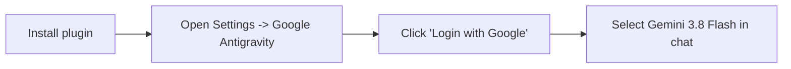

<div align="center">

# dsh-plugin-antigravity-acp

**DeepSeek Harness (DSH) plugin connecting Google Antigravity ACP runtime for Gemini 3.x models**

[English](README_en.md) · [简体中文](README.md)

[](https://github.com/deepseek-ai)
[](LICENSE)
[](package.json)
[](https://github.com/agentclientprotocol)

</div>

---

## Introduction

`dsh-plugin-antigravity-acp` is a plugin for **DeepSeek Harness (DSH)**. It connects to the Google Antigravity runtime using the standard Agent Client Protocol (ACP), allowing DSH to use Gemini 3.8 Flash models directly.

The plugin includes both a settings UI and background services. Once installed, log in via standard Google OAuth to start using Gemini 3.8 Flash with thought reasoning, streaming responses, and a 1-million-token context window.

---

## Features

- **Built-in Settings UI**: Injects a "Google Antigravity" tab into DSH's **Settings -> Plugins** and adds a direct entry in the sidebar without modifying config files manually.
- **Automatic Runtime Setup**: Automatically detects host OS (Windows, macOS, Linux) on first run, downloads the corresponding `agy_acp_server` binary from Google's official CDN, and verifies its SHA256 checksum. No local Python, GCC, or build tools required.
- **Official Google OAuth 2.0 Flow**: Uses standard ACP `oauth-personal` authorization. Opens the official Google login page in your default browser; credentials stay local, and no API keys or cookies need to be copied.
- **Native Model Integration & Streaming**: Adds `Gemini 3.8 Flash (Antigravity)` to the chat model selector. Supports real-time reasoning thought display and text streaming.
- **Quota & Tier Monitoring**: Built-in quota service displays your Google account tier and rate limits in real time.
- **Local Storage & Privacy**: No third-party relay servers and no telemetry tracking. Auth tokens are stored locally in `~/.gemini/antigravity-acp/`, and requests connect directly to Google APIs.

---

## Installation

### Method 1: Install via DSH GUI (Recommended)

1. Open the DSH desktop client.
2. Go to **Settings** -> **Plugins**.
3. Paste the repository URL:
   ```text
   https://github.com/Lovexiaoxiaowo/dsh-plugin-antigravity-acp
   ```
4. Click **Install**.

---

### Method 2: Install via DSH CLI

Run the following command in your terminal:

```bash
dsh plugin add https://github.com/Lovexiaoxiaowo/dsh-plugin-antigravity-acp
```

---

## Getting Started



1. **Open Settings**: After installation, go to DSH **Settings** -> **Plugins** -> **Google Antigravity** tab (or click **Google Antigravity** in the sidebar).
2. **Authorize Google Account**: Click **Login with Google**. The default browser will open the official Google authentication page. Once approved, the DSH panel updates to show connected status.
3. **Select Model and Chat**: Open any conversation, select `Gemini 3.8 Flash (Antigravity)` from the model dropdown, and start chatting.

---

## Security Comparison

| Aspect | Web Scraping / Mirror APIs | This Plugin (dsh-plugin-antigravity-acp) |
| :--- | :--- | :--- |
| **Protocol** | Web reverse-engineering / private endpoints | Official Google Agent Client Protocol (ACP) |
| **Binaries** | Unverified third-party binaries | Signed Google CDN binaries verified by SHA256 |
| **Authentication** | Cookie theft / private session harvesting | Official Google OAuth 2.0 personal flow |
| **Data Flow** | Relayed through third-party servers | Direct connection from local process to Google API |
| **Account Safety** | High risk of account suspension | Standard personal application access |

---

## Troubleshooting (FAQ)

### Q1: The model does not appear in the chat window after installing or updating.
- **Cause**: On Windows, closing the window with the `X` button minimizes DSH to the system tray by default, leaving the previous process running.
- **Fix**: Right-click the DSH icon in the Windows notification tray, select **Exit**, and relaunch DSH.

### Q2: Why is the model hidden before logging in?
- **Cause**: The plugin gates model availability until authentication succeeds to avoid invalid requests.

### Q3: Which platforms are supported?
- Windows (x64 / arm64), macOS (Apple Silicon / Intel), and Linux (x64 / arm64). The bootstrap script selects the right binary automatically.

---

## Project Structure

```
dsh-plugin-antigravity-acp/
├── cordis.patch.yml       # DSH bundle patch manifest
├── dsh/
│   └── client.js          # DSH frontend UI component
├── src/
│   ├── index.ts           # Service entry, LlmAdapter registration & Web bridge
│   ├── bootstrapper.ts    # Binary downloader & SHA256 checksum verification
│   ├── auth.ts            # OAuth token storage and refresh logic
│   ├── acp-client.ts      # ACP SDK client and streaming parser
│   ├── quota-service.ts   # Quota and tier status lookup
│   ├── session-manager.ts # Session context and lifecycle manager
│   ├── event-mapper.ts    # ACP events to DSH streaming events mapper
│   └── runtime-manifest.json # Download manifest and binary hashes
├── dist/                  # Precompiled files (included in git)
├── package.json
├── README.md              # Chinese documentation (Default)
└── README_en.md           # English documentation
```

---

## Contributing

Issues and Pull Requests are welcome:
- Repository: [GitHub Repository](https://github.com/Lovexiaoxiaowo/dsh-plugin-antigravity-acp)
- Issues: [Issues Tracker](https://github.com/Lovexiaoxiaowo/dsh-plugin-antigravity-acp/issues)

---

## License

This project is licensed under the [MIT License](LICENSE).
