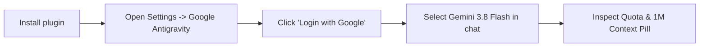

<div align="center">

# dsh-plugin-antigravity-acp

**DeepSeek Harness (DSH) plugin connecting Google Antigravity ACP runtime for Gemini 3.x models**

[English](README_en.md) · [简体中文](README.md)

[](https://github.com/deepseek-ai)
[](LICENSE)
[](package.json)
[](https://github.com/agentclientprotocol)

</div>

---

## Introduction

`dsh-plugin-antigravity-acp` is an extension plugin for **DeepSeek Harness (DSH)**. It connects to the Google Antigravity runtime using the standard Agent Client Protocol (ACP), allowing DSH to use Gemini 3.8 Flash models directly.

The plugin includes a dedicated settings UI and background services. Once installed, log in via standard Google OAuth to start using Gemini 3.8 Flash with thought reasoning, streaming responses, an interactive quota & 1M context pill next to the model selector, ACP plan/tool trajectory tracking, and zero-downtime cross-process session auto-recovery.

---

## Features

- **Interactive Quota & Context Pill**: Injects a native capsule badge (`⚡ 5h 95% | Context 7.2%`) immediately to the left of the chat input model selector. Clicking opens a Popover dashboard with Google's official 5-hour rolling window quota, reset countdown, 1M context usage bar, and token accounting (input/output/reasoning).
- **ACP Trajectory & Thought Process**: Maps ACP runtime thoughts (Reasoning Delta), tool calls, code diffs, and execution plans into DSH's reasoning and process view for complete observability.
- **Context Retention & Timestamp Penetration**: Intelligently identifies and penetrates DSH automated system injections (such as `@deepseek-ai/dsh-time-context` timestamps), extracting the genuine user query and preventing historical context loss.
- **Cross-Process Session Auto-Recovery**: Automatically diagnoses obsolete sessions (`Session not found / code: -32603`) caused by DSH client restarts or server-side expirations. Reconstructs previous conversational history and retries seamlessly without throwing `Internal error` to the user.
- **Built-in Settings UI**: Injects a "Google Antigravity" tab into DSH's **Settings -> Plugins** and adds a direct entry in the sidebar without editing config files.
- **Automatic Runtime Setup**: Automatically detects host OS (Windows, macOS, Linux) on first run, downloads the corresponding `agy_acp_server` binary from Google's official CDN, and verifies its SHA256 checksum.
- **Official Google OAuth 2.0 Flow**: Uses standard ACP `oauth-personal` authorization. Opens the official Google login page in your default browser; credentials stay local, and no API keys or cookies need to be copied.
- **Local Storage & Privacy**: No third-party relay servers and no telemetry tracking. Auth tokens are stored locally in `~/.gemini/antigravity-acp/`, and requests connect directly to Google APIs.

---

## Installation

### Method 1: Install via DSH GUI (Recommended)

1. Open the DSH desktop client.
2. Go to **Settings** -> **Plugins**.
3. Paste the repository URL:
   ```text
   https://github.com/Lovexiaoxiaowo/dsh-plugin-antigravity-acp
   ```
4. Click **Install**.

---

### Method 2: Install via DSH CLI

Run the following command in your terminal:

```bash
dsh plugin add https://github.com/Lovexiaoxiaowo/dsh-plugin-antigravity-acp
```

---

## Getting Started



1. **Open Settings**: After installation, go to DSH **Settings** -> **Plugins** -> **Google Antigravity** tab (or click **Google Antigravity** in the sidebar).
2. **Authorize Google Account**: Click **Login with Google**. The default browser will open the official Google authentication page. Once approved, the DSH panel updates to show connected status.
3. **Select Model and Chat**: Open any conversation, select `Gemini 3.8 Flash (Antigravity)` from the model dropdown, and start chatting.
4. **Interactive Dashboard**: Click the `⚡ 5h 95% | Context x%` badge located left of the model dropdown to inspect quota countdowns and token consumption.

---

## Security Comparison

| Aspect | Web Scraping / Mirror APIs | This Plugin (dsh-plugin-antigravity-acp) |
| :--- | :--- | :--- |
| **Protocol** | Web reverse-engineering / private endpoints | Official Google Agent Client Protocol (ACP) |
| **Binaries** | Unverified third-party binaries | Signed Google CDN binaries verified by SHA256 |
| **Authentication** | Cookie theft / private session harvesting | Official Google OAuth 2.0 personal flow |
| **Data Flow** | Relayed through third-party servers | Direct connection from local process to Google API |
| **Account Safety** | High risk of account suspension | Standard personal application access |

---

## Changelog

### v1.0.7
- **Full-Context Silent Auto-Recovery**: Catches `Session not found` and `-32603` internal errors, automatically purges stale sessions, recreates a fresh ACP instance, re-injects history, and retries transparently to eliminate `Internal error` on client restarts.
- **Task Cleanup**: Inspected and terminated hanging test background tasks.

### v1.0.6
- **Penetrate DSH Time Injections**: Distinguishes genuine user prompts from `@deepseek-ai/dsh-time-context` timestamps to eliminate misdirected responses.
- **1M Model Matching & Token Accounting**: Accurately bounds context to 1,048,576 (1M) tokens; fixes cumulative streaming notification counting that previously caused inflated 3.5M token displays and 100% usage alerts.

### v1.0.5
- **Quota & Context Pill**: Injected interactive capsule badge and Popover next to model dropdown for 5-hour quota and context tracking.
- **ACP Trajectory Mapping**: Streams ACP Plan and Tool invocations into DSH reasoning views.
- **Session Manager**: Implemented `DshSessionManager` for multi-turn conversational persistence.

### v1.0.4 & Earlier
- Fixed multi-tab deduplication, multi-platform binary bootstrapping, and standard OAuth 2.0 authorization.

---

## Troubleshooting (FAQ)

### Q1: The model does not appear in the chat window after installing or updating.
- **Cause**: On Windows, closing the window with the `X` button minimizes DSH to the system tray by default, leaving the previous process running.
- **Fix**: Right-click the DSH icon in the Windows notification tray, select **Exit**, and relaunch DSH.

### Q2: Why is the model hidden before logging in?
- **Cause**: The plugin gates model availability until authentication succeeds to avoid invalid requests.

### Q3: Which platforms are supported?
- Windows (x64 / arm64), macOS (Apple Silicon / Intel), and Linux (x64 / arm64). The bootstrap script selects the right binary automatically.

---

## Project Structure

```
dsh-plugin-antigravity-acp/
├── cordis.patch.yml       # DSH bundle patch specification
├── dsh/
│   └── client.js          # DSH frontend extension (Settings tab & input bar badge)
├── src/
│   ├── index.ts           # Service entry, LlmAdapter, Web server routes, & auto-recovery
│   ├── bootstrapper.ts    # Binary downloader & SHA256 verification
│   ├── auth.ts            # OAuth credential manager & token refresh
│   ├── acp-client.ts      # @agentclientprotocol/sdk client & stream handling
│   ├── quota-service.ts   # Google quota & tier query service
│   ├── session-manager.ts # Session manager, user prompt extractor, & history binding
│   ├── event-mapper.ts    # ACP events to DSH streaming chunk mapper
│   └── runtime-manifest.json # Official Google download URLs and SHA256 hashes
├── dist/                  # Precompiled build artifacts
├── package.json
├── README.md              # Chinese documentation (default)
└── README_en.md           # English documentation
```

---

## Contributing

Issues and Pull Requests are welcome:
- Repository: [GitHub Repository](https://github.com/Lovexiaoxiaowo/dsh-plugin-antigravity-acp)
- Issue Tracker: [Issues Tracker](https://github.com/Lovexiaoxiaowo/dsh-plugin-antigravity-acp/issues)

---

## License

This project is licensed under the [MIT License](LICENSE).
