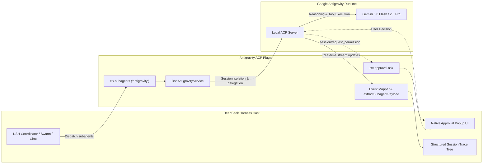

<div align="center">

# dsh-plugin-antigravity-acp

**DeepSeek Harness (DSH) Plugin: Connecting Google Antigravity ACP Runtime for High-Reasoning Gemini 3.x Models**

[English](README_en.md) · [简体中文](README.md)

[](https://github.com/deepseek-ai)
[](package.json)
[](https://github.com/agentclientprotocol)
[](LICENSE)

</div>

---

## 💡 Overview

`dsh-plugin-antigravity-acp` is a capability expansion plugin designed for **DeepSeek Harness (DSH)**. It connects to the local Google Antigravity runtime using the standard **Agent Client Protocol (ACP)**.

Instead of merely stuffing Antigravity into the main chat window as a generic model, this plugin integrates with DSH's native core seams: registering Antigravity as a **DSH Native Subagent Provider**, supporting native dispatch via the DSH Coordinator, `/swarm`, and `/teamwork`, while integrating with DSH's host-level **Interactive Approval** for robust security governance.

---

## 🚀 Key Features

- **DSH Native Subagent Dispatch (`ctx.subagents`)**  
  Registers `antigravity` and `antigravity-acp` subagent providers adhering strictly to DSH's `SubagentProvider` and `SubagentRun` contracts. Inherits parent workspace cwd, binds cancellation signals (`signal`), and produces structured `SubagentResult` outputs.
- **Host Interactive Security Approval (`ctx.approval`)**  
  Bridges ACP's `session/request_permission` events to DSH's native interactive approval popups (`ctx.approval.ask`). Supports `allowed-once`, `allowed-always`, and `rejected` decisions.
- **Structured Subagent Task Projection**  
  Built-in `extractSubagentPayload` extracts subtasks from ACP tool calls and swarm briefs, projecting clean hierarchical task trees in DSH traces.
- **Persistent Bottom Quota & Context Pill**  
  Injects a native status pill (`⚡ 5h 95% | Weekly Reset`) in the composer dock. Hovering opens an interactive Popover presenting Google's unique 5-hour rolling window and weekly reset countdowns.
- **Gemini 3.x / 2.5 Flagship Model Matrix**  
  Full access to Gemini 3.8 Flash (1M context), Gemini 2.5 Pro, Flash Thinking, and Google-hosted models, supporting full thought reasoning and multimodal vision inputs.
- **Transparent Self-Healing & Resilience**  
  Automatic cross-process session auto-recovery, stream backpressure watermark protection, and timeout circuit breakers.
- **Zero Config & Privacy First**  
  Automatically downloads and validates the official Google binary on startup. Authenticates via standard OAuth 2.0; credentials stay local, connecting directly to Google APIs without intermediate relays.

---

## 🛠️ Architecture



---

## 📦 Installation

### Method 1: Install via DSH GUI (Recommended)

1. Open the DeepSeek Harness desktop client;
2. Navigate to **Settings** -> **Plugins**;
3. Paste the repository URL into the installation input:
   ```text
   https://github.com/Lovexiaoxiaowo/dsh-plugin-antigravity-acp
   ```
4. Click **Install**.

### Method 2: Install via DSH CLI

Run the following command in your terminal:
```bash
dsh plugin add https://github.com/Lovexiaoxiaowo/dsh-plugin-antigravity-acp
```

---

## 🏁 Quick Start

1. **Authentication**: Go to **Settings** -> **Plugins** -> **Google Antigravity** tab. Click **Login with Google** to authorize via standard OAuth in your browser.
2. **Standard Chat**: Select `Gemini 3.8 Flash (Antigravity)` from the model selector in any conversation to start chatting.
3. **Subagent Collaboration**: Delegate complex tasks directly from coordinator or Swarm prompts:
   ```markdown
   Have the antigravity subagent review and refactor the parser module and produce test cases.
   ```

---

## 📋 Model Matrix

| Model | Context Window | Thought Reasoning | Ideal Use Cases |
| :--- | :---: | :---: | :--- |
| **Gemini 3.8 Flash** | 1,048,576 Tokens | ✅ Supported | High-speed coding, full-repo reading, daily driver |
| **Gemini 2.5 Pro** | 1,048,576 Tokens | ✅ Supported | Complex architectural refactoring and deep reasoning |
| **Gemini 2.5 Flash Thinking** | 1,048,576 Tokens | ✅ Visible Chain | Fine-grained step audits and logic verification |
| **Gemini 3.5 Flash Lite** | 1,048,576 Tokens | ✅ Supported | Lightweight rapid queries and helper tasks |
| **Claude Opus / Sonnet (Hosted)** | 200,000 Tokens | ✅ / ❌ | Google-hosted Claude high-precision models |

---

## ❓ Frequently Asked Questions (FAQ)

<details>
<summary><b>Q1: Why is Antigravity missing from the model list before login?</b></summary>
To avoid unexpected invocation errors when unauthenticated, models are injected into DSH only after successful Google OAuth authorization.
</details>

<details>
<summary><b>Q2: How do I reload updated plugin code into DSH?</b></summary>
Because the DSH background server holds active modules, press <code>Ctrl+R</code> in the DSH window or restart the client to load the updated code.
</details>

<details>
<summary><b>Q3: What does the 5-hour rolling window mean?</b></summary>
Google Antigravity uses a dynamic 5-hour rolling quota window rather than a fixed daily or midnight reset. Quotas recover smoothly once usage slides past the window boundary.
</details>

---

## 📄 Changelog & License

- **Changelog**: Detailed release notes and historical upgrades are maintained in [CHANGELOG.md](CHANGELOG.md).
- **License**: Released under the [MIT License](LICENSE).
